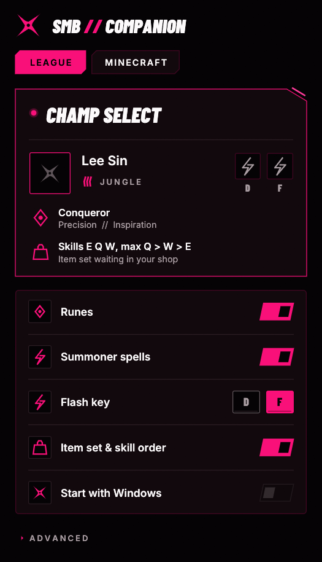
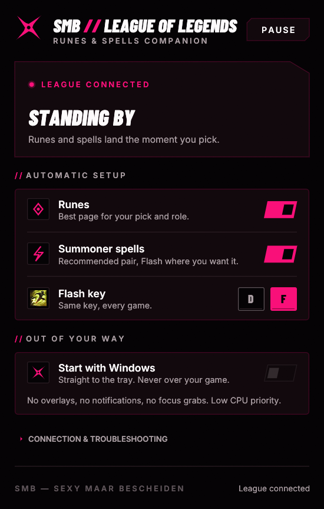

<p align="center">
  
</p>

<h1 align="center">SMB Companion</h1>

<p align="center">
  <b>SMB — Sexy Maar Bescheiden.</b> Dutch for “Sexy, but modest.”<br>
  The small companion app for SMB players. For League of Legends: runes and summoner spells in champion select. Nothing else.
</p>

<p align="center">
  
  &nbsp;
  
</p>

## What it does

- **Runes.** Applies a recommended rune page for your champion and role the moment you pick.
  It writes to one page of its own (`SMB // Lee Sin · Jungle`). Your own pages are never edited or deleted.
- **Summoner spells.** Sets the recommended pair with Flash on your key. It learns that key from your own
  games: where you left Flash last time, or where you move it in champion select. Nothing to set up.
- **Shows its work.** Champion, role, keystone, rune trees and the spells on D/F, in League's own art,
  loaded from your local client. Hover for names in your client's language.
- **Item set & skill order** *(optional, off by default)*. OP.GG's most played build as an item set in
  your in-game shop, with the skill order in its first row. One set of its own; your other item sets stay as they are.
- **Modes.** Ranked, normals, ARAM, ARAM Mayhem, URF, Arena and Swiftplay. Sits TFT out.

## Stays out of your game

The game has the focus. The companion doesn't ask for it.

- It never opens, raises or focuses a window by itself. It only appears when you click the tray icon or launch it again.
- Launched while a game is already running? It starts in the tray.
- **Start with Windows** goes straight to the tray, silently.
- No overlays, no notifications, no taskbar flashing, no always-on-top.
- Runs at below-normal CPU priority and polls less while a game is in progress.
- One instance at a time. It talks only to the League client's local API (LCU), and only writes during champion select.
  It never touches the game process, its memory or its files.

## Install

Grab one from [Releases](../../releases/latest):

| | **Installer** `smb-companion-<version>-setup.exe` | **Portable** `smb-companion-<version>-portable.zip` |
| --- | --- | --- |
| Admin rights | Not needed (installs for your user only) | Not needed |
| Where | `%LOCALAPPDATA%\Programs\SMB Companion` | Any folder you unzip it to |
| Settings | `%APPDATA%\SMB\LoL Companion` | Inside that folder |
| Extras | Start menu, optional desktop shortcut and *Start with Windows*, uninstaller | — |
| Updating | Automatic: installs new versions by itself while League is closed | Replace `smb-lol.exe`; the app shows when a new version is out |

Builds are **not code-signed yet**, so Windows SmartScreen will warn you: choose **More info → Run anyway**.
Compare the file against `SHA256SUMS.txt` if you like to be sure.

Close the window and it keeps running in the tray. Right-click the shuriken for
**Open**, **Automatic runes & spells** (on/off) and **Quit**.

**Uninstall.** Installer: *Settings → Apps → SMB Companion*. Your settings file is kept.
Portable: switch off *Start with Windows*, quit from the tray, delete the folder.

Portable mode comes from the `smb-lol.portable` file next to the exe. Delete it and the same exe uses `%APPDATA%` instead.

Coming from the earlier *Quiet Select* build? Quit it first. This app takes over its rune page instead of making a second one.

## Good to know

- Recommendations come from OP.GG's public champion data. SMB and this project are not affiliated with OP.GG.
  No internet, or OP.GG unavailable? League's own recommended runes and spells fill in. Nothing is guessed.
- Rune page slots full? Delete one in the client and the companion takes it from there.
  Nothing of yours gets deleted to make room.
- Problems retry on their own. **Activity log** (under *Connection & troubleshooting*) shows what happened and when.
- The installed version checks this repository's GitHub releases once a day. A new installer is checked against
  `SHA256SUMS.txt` and installed silently when you're not queueing, in champion select, in a game or looking at the window.
- Third-party tools that use the League client API are common (rune importers, stat sites). Use it at your own discretion.

## Build from source

Requires Rust (stable, MSVC toolchain) on Windows.

```sh
cargo test
cargo test -- --ignored        # also downloads and verifies the latest release from GitHub
cargo build --release          # target/release/smb-lol.exe
```

Development flags:

| Flag | Effect |
| --- | --- |
| `--background` | Start in the tray (what *Start with Windows* uses). |
| `--quit` | Close a running copy cleanly (used by the installer). |
| `--demo --screenshot out.png` | Render a sample champion-select state to a PNG and exit. |
| `--screenshot out.png --live` | Connect to the local client for 6 s, then capture. |

The shuriken icons and installer artwork are generated by `python tools/make_icons.py` (Pillow).

## Packaging and releasing

`packaging/package.ps1` turns a release build into the installer (Inno Setup 6.7+, `packaging/smb-lol.iss`),
the portable zip and `SHA256SUMS.txt` in `dist/`. CI does this on every push and keeps the result as a build artifact.

```powershell
cargo build --release
./packaging/package.ps1 -Iscc "C:\path\to\Inno Setup 6\ISCC.exe"
```

To publish, bump `version` in `Cargo.toml`, then push a matching tag. GitHub Actions tests, packages and creates the release:

```sh
git tag v0.3.0
git push origin v0.3.0
```

Builds are unsigned for now. Installed copies pick up a new release by themselves within a day.

## Brand

Styled to the SMB Brand Guide v1.0 (“Neon Shinobi Noir”): Void Black, Blade White and SMB Neon Pink `#F91079` only,
Barlow Condensed and Inter, 12° diagonals, sharp 0–4 px corners, `//` labels, dry copy.
The shuriken here is a provisional geometric rendering of the compact SMB mark until the official vector master exists.

## License and legal

Code: [MIT](LICENSE). Fonts: SIL Open Font License, see [THIRD_PARTY_NOTICES.md](THIRD_PARTY_NOTICES.md).
The SMB name, shuriken mark and visual identity belong to SMB — Sexy Maar Bescheiden and are not covered by the MIT license.

SMB Companion isn't endorsed by Riot Games and doesn't reflect the views or opinions of Riot Games or anyone
officially involved in producing or managing Riot Games properties. Riot Games and all associated properties are
trademarks or registered trademarks of Riot Games, Inc. No Riot artwork is bundled; icons are read from your own
installed League client at runtime.

<p align="center"><sub>Play hard. Stay modest.</sub></p>
